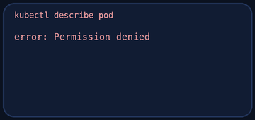
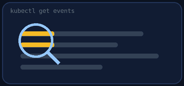
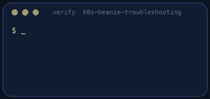
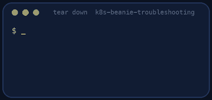

<p align="center"></p>

| | |
|-|-|
| **Time** | 90-105 min |
| **Cost** | free on a local cluster |
| **You need** | Docker, kubectl, git, curl, Python 3 and a local Kubernetes cluster (kind, OrbStack or Docker Desktop) running |

## How this lab works

1. **Fork** this repository to your own GitHub account (button at the top right).
2. Clone **your fork** in your Ubuntu environment (WSL on Windows, your OrbStack machine on Mac).
3. Read the lab below (the same text is in [`LAB.md`](LAB.md)) and follow the mission.
4. Answer the questions in [`SUBMISSION.md`](SUBMISSION.md). Where a question asks for output, paste it in a code block. No screenshots needed.
5. Commit and push. Open the **Actions** tab of your fork (click *I understand my workflows, go ahead and enable them* the first time). The **Lab check** shows what is still missing.
6. When the check is green, **submit the URL of your fork** in the course platform.

> [!NOTE]
> The check only looks at your answers and any files the lab asks you to commit. Your instructor reads your work and may ask you to explain any line.

<p align="center"></p>

## 🎬 The situation

<p align="center"></p>

```text
CASE FILE 2291 - "The Saturday Queue"
Opened by  : the cafe owner, 08:40, twenty minutes before opening
Complaint  : "The ordering system shows nothing but red."
Scene      : namespace beanie-broken, one local cluster, six workloads
Detective  : you
Witnesses  : kubectl, and nobody else. The colleague who made the changes went hiking.
```

You open the scene and `kubectl get pods` is a wall of red: `ImagePullBackOff`, `Pending`, `CrashLoopBackOff`, `0/1`, `OOMKilled`. On Friday evening a colleague made six "small cleanups" and left. The queue starts at 9:00.

Real incidents are rarely one thing. They are several small, unrelated mistakes stacked on top of each other, and a good detective does not need to know the culprit in advance: she has a **method** that says, for any broken pod, where to look next. Kubernetes is very good at telling you what is wrong, if you ask the right object. You will work the case with `kubectl` and nothing else, one exhibit at a time.

> [!IMPORTANT]
> **Your mission**
> - Start the broken namespace and look at it
> - For each of the six faults: find the command that shows the cause, read the line that matters, fix it
> - Write down, for each, the command and the line (your diagnosis notes are part of the grade)
> - Get an order through the gateway when everything is repaired
> - Tear down and prove it

**Time:** 90-105 min | **Cost:** free on a local cluster | **You need:** Docker, `kubectl`, git, curl, Python 3 and a local Kubernetes cluster running (kind, OrbStack or Docker Desktop with Kubernetes enabled). Check with `kubectl get nodes`.

<p align="center"></p>

## Open the case: the scene

Fork this repository, clone your fork and run:

```bash
./setup.sh
kubectl get pods -n beanie-broken
```

`setup.sh` builds the Beanie image, then renders the manifests of `broken/` into `fixed/` and applies them. The files in `fixed/` are the **broken** ones, on purpose; you repair them there and commit the repairs. Keep `kubectl get pods -n beanie-broken -w` open in a second terminal.

<p align="center"></p>

## Standing procedure: five questions, always in this order

<p align="center"></p>

Always the same five questions, in this order:

1. **`kubectl get pods`**: what is the *status* and the *READY* column? (`Pending`, `ImagePullBackOff`, `CrashLoopBackOff`, `Running 0/1` are four different stories.)
2. **`kubectl describe pod <name>`**: read the **Events** at the very bottom, and `State`, `Last State`, `Reason`, `Exit Code`.
3. **`kubectl logs <pod>`** (and `--previous` for a container that restarted): what did the process say before it died?
4. **`kubectl get events -n <ns> --sort-by=.lastTimestamp`**: the cluster's own diary of what it tried.
5. **`kubectl get endpoints <svc>`** and **`kubectl get svc <svc> -o yaml`**: is anything behind the Service?

> [!NOTE]
> **Predict** A pod is `Pending` with no restarts at all. Which component has not done its job yet: the scheduler, the kubelet or the container runtime? And for a pod that is `Running 0/1` with zero restarts?

<p align="center"></p>

## The exhibits: six faults, one at a time

Work through the exhibits in any order. For each one, record in `DIAGNOSIS.md` (the numbers match its headings) **the command** you ran and **the line** of its output that showed the cause: the evidence, not the guess.

| Exhibit | Where | What you see | Where to look |
|---|-------|--------------|---------------|
| 1 | `menu` | the pods never start | `describe pod`: the Events say why the image cannot be fetched |
| 2 | `payments` | the pod just sits there | `describe pod`: a scheduling message about what the node cannot provide |
| 3 | `orders` | it starts, dies, restarts, dies | `logs --previous`: what did the process print? |
| 4 | `gateway` | `Running`, but `0/1`, forever | `describe pod`: the readiness probe's failure message |
| 5 | `notifications` | the pods are fine, but nobody can reach the Service | `get endpoints`, then compare the Service selector with the pod labels |
| 6 | `reporter` | restarts every few seconds | `describe pod`: `Last State`, `Reason`, `Exit Code` |

Repair each in `fixed/<file>.yaml` and apply it:

```bash
kubectl apply -f fixed/
kubectl get pods -n beanie-broken -w
```

Do not skip the notes: "I saw it was a typo" is not a diagnosis. The command and the line are.

> [!NOTE]
> **Think** Fault 6 killed its process with exit code 137. Exit codes above 128 mean *killed by signal (code − 128)*, and 137 is signal 9. Who sent the signal: the application, the kubelet or the kernel? What is the difference between the memory **request** and the memory **limit** of a container? What would have happened to a container that exceeded its **CPU** limit instead?

<p align="center"></p>

## Reconstruction: does the whole system work?

When all six are repaired, every pod is `Running` and `Ready`. Prove that the five Beanie services talk to each other again:

```bash
kubectl port-forward -n beanie-broken svc/gateway 8000:8000 &
curl -s -X POST localhost:8000/api/orders -H 'Content-Type: application/json' \
  -d '{"customer": "Ana", "items": [{"item_id": "flat-white", "quantity": 2}]}'
```

A paid order means the gateway reached orders, orders reached menu, payments and notifications. If it fails, one of your "fixes" only moved the problem: follow the request with `kubectl logs` of the service named in the error.

<p align="center"></p>

## Verdict - Prove it

<p align="center"></p>

```bash
./verify.sh
```

It inspects each fault in the cluster, waits for the repaired pods, places an order through the gateway and reads your diagnosis notes. Fix what is red and run it again until it ends with **ALL CHECKS PASSED**.

> [!TIP]
> **Stuck?** Nothing changes after `kubectl apply`: the Deployment spec did not change (check you edited `fixed/`), or you are looking at old pods (`kubectl rollout status`). A pod stays `Terminating`: wait, or `--grace-period=0 --force` as a last resort. The Service still has no endpoints: `kubectl get pods --show-labels` next to `kubectl get svc -o yaml`. Fault 6 comes back: the limit you set is still smaller than what the process allocates.

<p align="center"></p>

## Level up (optional)

- Write a one-page runbook "my pod is not running" from your notes, as a decision tree.
- Use `kubectl debug` (an ephemeral container) on a running pod, and `kubectl run` a throw-away pod to test a Service by name with `curl`.
- Add a `startupProbe` to `orders` and explain what it would have changed for fault 3 (nothing) and for a slow-starting but healthy process.
- Break something new on purpose in a copy of `fixed/` and ask a classmate to diagnose it using only the method above.

<!-- teardown:start (generated by labs.py, do not edit) -->
## Tear down (mandatory)

<p align="center"></p>

Resources left behind cost money, keep doors open and pollute the next lab. Removing what you created is part of the job, so it is part of the submission: **you must prove it is gone**.

Do this **last**, after you have pasted your `verify` output into `SUBMISSION.md` (once you tear down, the lab can no longer be verified).

1. Run `./teardown.sh`. It deletes the namespace `beanie-broken` (everything in it) and the cloned Beanie source.

Then run the proof:

```bash
./verify-teardown.sh
```

It prints a list of checks and must end with **TEARDOWN VERIFIED**. If it reports leftovers, remove them and run it again. Paste the full output in your submission.
<!-- teardown:end -->

<!-- submission:start (generated by labs.py, do not edit) -->
## 📬 Submission

Answer the questions in `SUBMISSION.md` in **your fork** (paste output in code blocks where asked), push, then submit the **URL of your fork**.

**Files to commit**

- `DIAGNOSIS.md`: for each fault, the command that showed it and what it said
- `fixed/` with your corrected manifests (optional: you may also patch the cluster directly)

**Questions to answer**

1. For each of the six faults paste the one command that revealed it and the one line of its output that told you what was wrong. Which of `get`, `describe`, `logs` and `get events` answered which fault?
2. A pod is `Pending`, one is `ImagePullBackOff`, one is `CrashLoopBackOff` and one is `Running 0/1`. Put these four on a line from "the scheduler could not place it" to "the container ran and failed". Which component is responsible at each step?
3. Why did `kubectl logs` show nothing useful for the pod that could not pull its image, and what did you use instead? And for the crash-looping pod, why do you need `--previous`?
4. The Service had no endpoints although its pods were healthy. How do you check which pods a Service selects (one command) and why does a label typo fail silently?
5. The reporter pod was killed with `OOMKilled` (exit code 137). Where do you see that, what is the difference between a memory request and a memory limit, and what happens to a pod that exceeds its CPU limit instead?
6. Order the checks you now do on any broken workload, in the order you would do them at 3 a.m. Which one would you automate first?
7. Paste the output of `./verify.sh`. It must end with **ALL CHECKS PASSED**.
8. **Tear down.** Paste the output of `./verify-teardown.sh`. It must end with **TEARDOWN VERIFIED**.
<!-- submission:end -->
